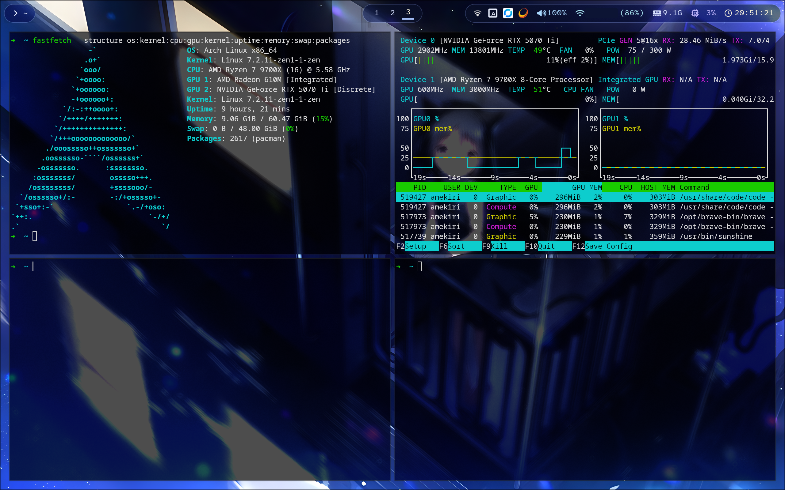

# Hyprland Dotfiles

Personal desktop configuration using Hyprland's Lua configuration, a glass-style Waybar, Dunst, Kitty, Hyprlock and Hyprpaper. These files are tailored to one machine, not a universal installer.



## Current setup

Verified on 2026-10-26:

| Component | Configuration |
| :--- | :--- |
| Hyprland | 0.56.2, Lua configuration provider |
| Waybar | 0.15.0 |
| CPU | AMD Ryzen 7 9700X, 8 cores / 16 threads |
| GPU | NVIDIA GeForce RTX 5070 Ti |
| Monitor | `DP-2`, 2560×1600 at 240 Hz, scale 1.6 |
| Display settings | 10-bit output, HDR, `sdrbrightness = 3.0` |
| Terminal / file manager / launcher | Kitty / Dolphin / Hyprlauncher |
| Notifications / input method | Dunst / Fcitx5 |

The current Lua configuration has no proxy environment variables and does not use the old multi-monitor workspace mapping. Older files elsewhere in the repository still contain settings from previous setups.

## Current configuration files

| Repository path | Local destination | Purpose |
| :--- | :--- | :--- |
| `hypr/hyprland.lua` | `~/.config/hypr/hyprland.lua` | Main compositor configuration, startup commands, window/layer rules and keybindings |
| `hypr/hypridle.conf` | `~/.config/hypr/hypridle.conf` | Idle locking, display power management and sleep hooks |
| `hypr/hyprlock.conf` | `~/.config/hypr/hyprlock.conf` | Lock screen |
| `hypr/hyprpaper.conf` | `~/.config/hypr/hyprpaper.conf` | Wallpaper |
| `hypr/obs-dunst-quiet.sh` | `~/.config/hypr/obs-dunst-quiet.sh` | Suppress notification popups while OBS is running |
| `dunst/dunstrc` | `~/.config/dunst/dunstrc` | Notification appearance and the `obs_quiet` rule |
| `kitty/kitty.conf` | `~/.config/kitty/kitty.conf` | Terminal opacity and window settings |
| `waybar/config` | `~/.config/waybar/config.jsonc` | Waybar modules and interactions; note the different filename |
| `waybar/style.css` | `~/.config/waybar/style.css` | Glass-style appearance |
| `waybar/compute-view.sh` | `~/.config/waybar/compute-view.sh` | CPU/GPU display and CPU thread tooltip |
| `waybar/memory-view.sh` | `~/.config/waybar/memory-view.sh` | RAM display and RAM/swap tooltip |

Copy the OBS helper and Dunst configuration together: the helper toggles the named `obs_quiet` rule. It detects whether the `obs` process is running, not whether recording or streaming is active. Notifications remain in history while popups are suppressed.

## Before using on another machine

Back up your existing configuration and review each file before copying it. Do not replace your entire `~/.config` directory with this repository.

- **Hyprland version:** the main configuration uses the `hl.*` Lua API and was verified with Hyprland 0.56.2. Older versions without this API cannot load it; newer versions may need adjustments. Ensure your session loads `hyprland.lua`, not the legacy `hyprland.conf`.
- **Monitor:** edit the `hl.monitor` block for your connector, resolution, refresh rate and scale. HDR, 10-bit output and brightness settings are hardware-specific, not recommended defaults for every display.
- **Personal paths:** the Lua startup block references `/home/amekiri/.config/hypr/obs-dunst-quiet.sh`. Change this to your own path and preserve the script's executable permission.
- **Wallpaper:** both Hyprlock and Hyprpaper reference `/home/amekiri/Pictures/Wallpaper/ComfyUI_00393_.png`. This image is not included. Provide your own wallpaper and update both paths.
- **Session services:** review the startup commands for KDE authentication agents, KWallet, NetworkManager, Fcitx5 and other applications. Executable names and `/usr/lib/` paths vary across distributions; avoid starting duplicate services already managed by your session.
- **Window rules:** review the application-specific rules, including game/Steam rendering and tone-mapping choices, before reusing them.
- **Locking:** the copied Hyprlock configuration sets `grace = 3`, allowing dismissal without authentication during the initial three-second grace period. Adjust this to your security preference.
- **Waybar config filename:** install `waybar/config` as `config.jsonc` and avoid leaving a competing old `config` in the same directory. Keep both custom scripts beside the installed configuration.

These are snapshots copied from the local configuration. They intentionally retain machine-specific paths and settings rather than silently rewriting them for portability.

## Dependencies and fonts

Install the tools for the features you intend to use; package names depend on your distribution.

| Feature | Required tools / services |
| :--- | :--- |
| Desktop and bar | Hyprland with Lua support, Waybar with `ext/workspaces` support |
| Locking and wallpaper | Hypridle, Hyprlock, Hyprpaper, `loginctl` with working session locking |
| Notifications | Dunst with `dunstctl rule` support; `flock` and `pgrep` for the OBS helper |
| Applications | Kitty, Dolphin, Hyprlauncher |
| Input method | Fcitx5 plus your chosen input-method engines |
| Network tray | NetworkManager and `nm-applet` |
| Audio | An audio setup supported by Waybar's PulseAudio module; `wpctl` for right-click mute, normally provided with WirePlumber |
| GPU statistics | NVIDIA driver and `nvidia-smi` for this machine's GPU mode |
| Screenshots | `grim`, `slurp`, `wl-copy` (wl-clipboard) |
| Authentication / wallet | KDE Polkit agent and KWallet, if retaining the corresponding startup commands |
| Helper scripts | POSIX shell, `awk`, standard Linux utilities, `/proc`, `/sys` and `XDG_RUNTIME_DIR` |

Waybar and Dunst explicitly use **AtkynsonMono Nerd Font**. Install that font, including its Nerd Font glyphs, or change the font names in `waybar/style.css` and `dunst/dunstrc`. Hyprlock uses system font fallbacks, including `sans-serif`; the current Kitty configuration does not set a custom font family. Install suitable CJK fallback fonts if needed.

The older `fontconfig/` and `fcitx5/` directories have not been synchronized to the current machine. They are not authoritative descriptions of its current font or input-method settings.

## Waybar interactions

- **Workspaces:** `ext/workspaces` uses the Wayland workspace protocol for Lua-compatible activation. Only existing workspaces are shown. Numeric workspace names sort numerically, with `sort-by-id` disabled and `sort-by-name` enabled. The normal keybindings target workspaces 1–10; the bar does not impose a 1–10 filter.
- **Window title:** follows the active window's title.
- **CPU/GPU:** click to switch modes. CPU is the initial mode when no runtime state exists; its tooltip shows usage for all 16 logical CPUs on this machine.
- **Memory:** click to toggle used GiB (displayed as `G`) and percentage. The tooltip includes RAM and swap usage.
- **Audio:** scroll to adjust volume; right-click to toggle mute.
- **Clock:** uses local system time; right-click changes the calendar mode.
- **Appearance:** translucent blue panels and menus are paired with the Waybar blur layer rule in `hyprland.lua`.

CPU/GPU and memory display choices are stored in `XDG_RUNTIME_DIR`; these runtime files do not belong in the repository.

## Main keybindings

`Super` is the main modifier.

| Shortcut | Action |
| :--- | :--- |
| `Super + Q` | Open Kitty |
| `Super + E` | Open Dolphin |
| `Super + R` | Open Hyprlauncher |
| `Super + C` | Close the active window |
| `Super + V` | Toggle floating |
| `Super + L` | Lock the session |
| `Super + M` | Exit using Hyprshutdown, with a Lua dispatcher fallback |
| `Super + arrow keys` | Move focus |
| `Super + 1…9, 0` | Switch to workspaces 1…9, 10 |
| `Super + Shift + 1…9, 0` | Move the active window to a workspace |
| `Super + [` / `]` | Switch to the previous / next numbered workspace |
| `Super + mouse wheel` | Cycle through existing workspaces |
| `Super + left / right mouse drag` | Move / resize a window |
| `Print` | Save a screenshot and copy it to the clipboard |
| `Shift + Print` or `Super + Shift + G` | Save a selected region and copy it to the clipboard |
| `Ctrl + Print` | Copy a selected region to the clipboard |

Saved screenshots go to `~/Pictures/Screenshots/`.

## Idle and display power management

`hypridle.conf` requests a session lock after 300 seconds and turns displays off after 330 seconds. Activity turns displays on again. It also requests locking before sleep and restores display power after waking. Automatic suspend is disabled in this snapshot.

Display power commands use the Lua dispatcher syntax, for example:

```sh
hyprctl dispatch 'hl.dsp.dpms({action = "on"})'
```

Do not substitute legacy `hyprctl dispatch dpms on/off` commands in this Lua-provider setup. Hypridle still uses its own `.conf` format; only the commands it sends to Hyprland need Lua syntax. Restart Hypridle after changing its configuration; reloading Hyprland alone does not apply those changes.

## Legacy files and synchronization

The following are retained for reference and are not part of the current configuration set above:

- `hypr/hyprland.conf`: the legacy Hyprland configuration, not kept in sync with `hyprland.lua`.
- `alacritty/`, `mako/`, `tofi/` and `waybar/config-upperbar/`: alternative or older application configurations.
- `fish/`, `fcitx5/` and `fontconfig/`: existing configurations not verified as current local snapshots.
- `hypr/xdph.conf` and `hypr/xdph-nuclear.sh`: older portal settings and a portal restart helper; review separately rather than deploying automatically.

`hypr/.luarc.json` can be kept as an editor aid: it points to Hyprland's Lua type stubs under `/usr/share/hypr/stubs`.

**Do not run the existing `update.sh` as a safe installer or sync command.** It deletes repository directories before copying local directories, lacks failure checks, omits Dunst and Kitty, and can import backups or stale files. It also loses the intentional Waybar `config` / `config.jsonc` filename mapping. It is retained unchanged for now; synchronize an explicit list of files instead and review the diff before committing.

Do not include configuration backups, runtime state, input-method learning data, credentials or personal history when sharing your setup.

## License

[MIT](LICENSE). Third-party assets such as fonts and wallpapers retain their own licenses; the repository license does not grant redistribution rights to those assets.
